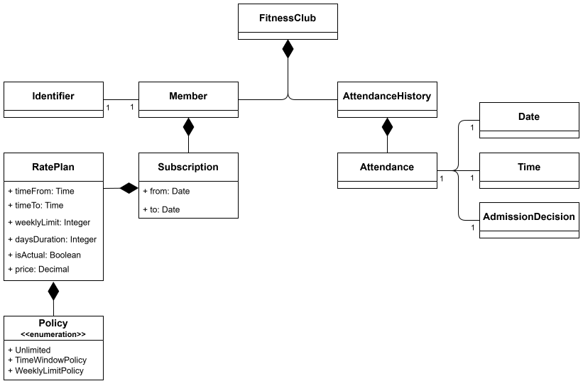

### Задание
Разработать систему учета посетителей в спортклубе. Имеются различные планы посещений: неограниченный,
только в первой половине дня, только во второй половине дня, 3 раза в неделю. По идентификатору
посетителя, дате, времени и истории посещений принимается индивидуальное решение о допуске в
клуб. Реализовать операции: регистрация посетителя и тарифного плана, регистрация посещения с
проверкой доступа.

### Модель предметной области

### Случаи использования (use cases)
- Регистрация посетителя (Member)
- Регистрация тарифного плана (RatePlan)
- Назначение тарифного плана (RatePlan) на посетителя (Member)
- Регистрация посещения (Attendance) с проверкой доступа
- Поиск пользователя по email-адресу
- Обновление цены тарифного плана
- Поиск тарифных планов (RatePlan)
- Удаление тарифного плана (RatePlan)
- Регистрация нового администратора
- Аутентификация администратора

Подробнее: [документация случаев использования](!docs/UseCases.md).

Также в папке [!docs](./!docs/) расположены [диаграммы классов](!docs/classesDiagrams/) (по одной на каждый микросервис) и [диаграммы последовательности](!docs/sequenceDiagrams/).

